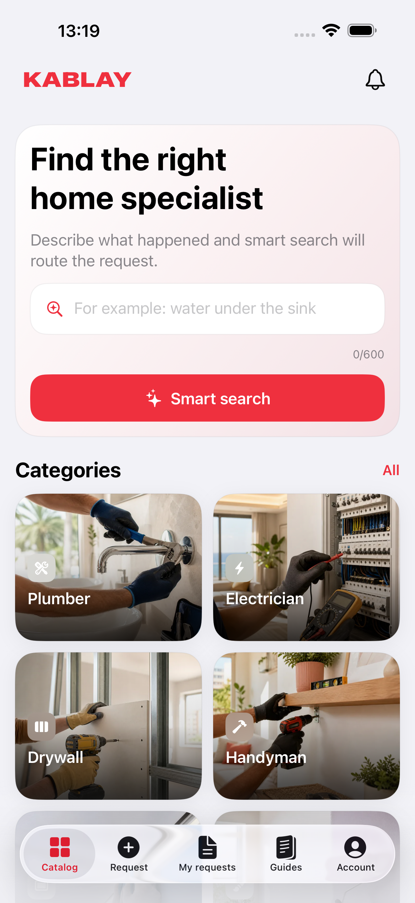
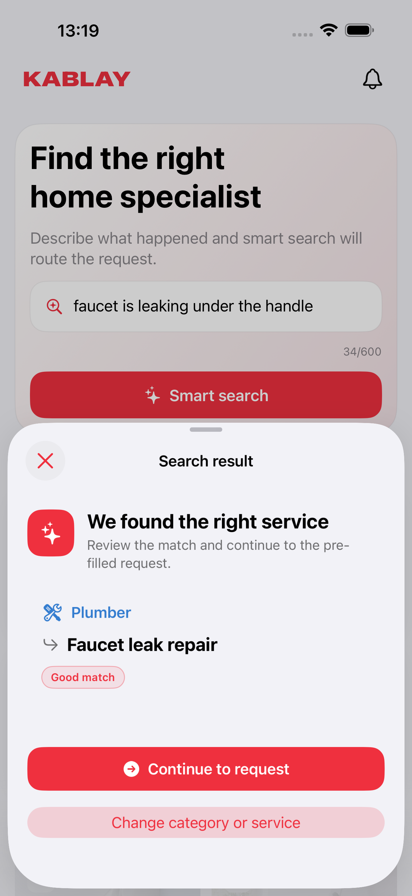
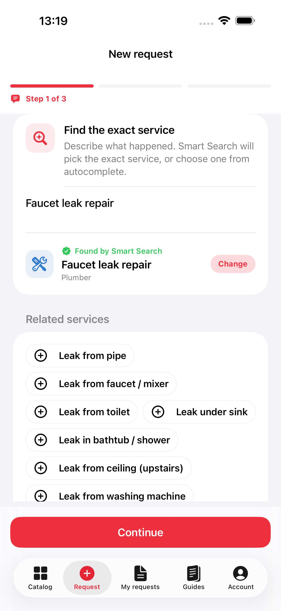
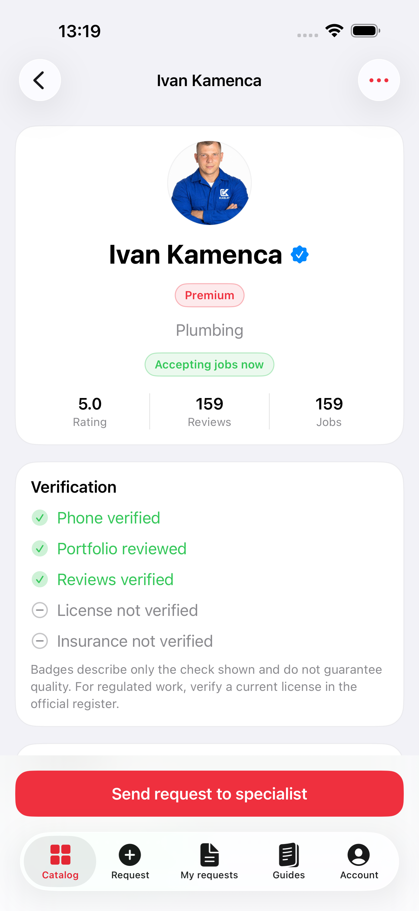
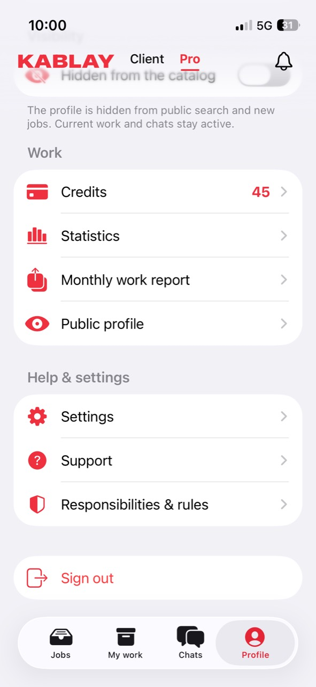

# KABLAY IL

**A native iPhone and iPad app for home repair in Israel.** Clients describe a job, compare specialists and proposals, and follow the work through completion. Professionals manage leads, conversations, active jobs, credits, and their public profile in the same app.

<p align="center"></p>

   

[Website](https://kablay.co.il/en) · [Complete screenshot gallery](docs/gallery.md) · [Support](https://kablay.co.il/en/app-support) · [Privacy policy](https://kablay.co.il/en/privacy)

This is the **public source repository for the iOS application**, version **1.0.0, build 41**. The marketplace server, deployment configuration, credentials, signing material, and App Review account details are kept separately. The source is available for inspection under the [KABLAY Public Source License](LICENSE); public visibility does not make it open source or grant commercial reuse.

## How the app works

1. **Find a service.** Browse home repair categories or describe the problem in Hebrew, Russian, or English. Smart Search suggests a specific service; the client can change it.
2. **Create a request.** Add details, photos, timing, budget, city and a map pin. The request stays visible in *My requests* as it progresses.
3. **Choose a professional.** Compare proposals, price, profile, verification labels, portfolio and reviews. Message the professional and record the agreed work.
4. **Finish with a record.** Confirm the result and amount paid, then leave a review tied to completed work.

The **Pro workspace** has four areas: *Jobs* for relevant requests, *My work* for accepted and completed jobs, *Chats* for client conversations, and *Profile* for availability, credits, statistics and the public portfolio. Credit packs and a monthly auto-renewing Premium subscription can be purchased with StoreKit; the server verifies Apple transactions before changing an account balance or entitlement. The purchase screen shows Apple's local price and renewal terms, and provides a restore option.

## Screenshots

These are captures of the running app. The full gallery has **25 screens** across iPhone and iPad, in English, Russian and Hebrew, including the Pro workspace. Open an image for its original size.

| Catalog | Smart Search | Request |
| :---: | :---: | :---: |
| <a href="docs/app-store/screenshots/01-catalog.png"></a> | <a href="docs/app-store/screenshots/02-smart-search.png"></a> | <a href="docs/app-store/screenshots/03-request.png"></a> |

| Specialist profile | Pro workspace |
| :---: | :---: |
| <a href="docs/app-store/screenshots/04-specialist.png"></a> | <a href="docs/app-store/screenshots/pro-01-workspace.jpg"></a> |

**[Browse all screenshots by device and language →](docs/gallery.md)**

The App Store product-page [header and search images](docs/app-store/creative-assets/README.md) are available in English, Russian and Hebrew. They use the screenshots above and include the source generator and exact pixel dimensions.

## What is included

| Area | Main capabilities |
| --- | --- |
| Client | Catalog, Smart Search, request wizard, city and map selection, proposals, specialist profiles, chat, completion and verified reviews |
| Professional | Job feed, offers, work tracking, chat, profile and portfolio, credits, Premium, monthly work-journal exports |
| Platform | SwiftUI, Hebrew RTL, Russian and English, Apple Maps, camera and photo library, push notifications and deep links, Face ID and app PIN |
| Offline | Bundled categories and saved articles, specialists, recent requests, jobs, conversations and images with last-updated labels; writes wait for a connection |

Read the [offline freshness and retention policy](docs/offline-behavior.md) for exact refresh intervals and what remains available without a network.

## Build locally

Use a Mac with **Xcode 26 or newer** (the source uses iOS 26 SDK symbols while supporting iOS 18+ at runtime) and [XcodeGen](https://github.com/yonaskolb/XcodeGen). The checked-in Xcode project is generated from `project.yml`.

```bash
xcodegen generate
open KablayIL.xcodeproj
```

For a simulator build, no signing credentials are needed:

```bash
xcodebuild -project KablayIL.xcodeproj -scheme KablayIL \
  -destination 'generic/platform=iOS Simulator' CODE_SIGNING_ALLOWED=NO build
```

Select an available simulator in Xcode to run the unit and UI tests. To install on a physical device, select your own Apple Development team in Xcode. The release bundle identifier is `il.co.kablay.app`; signing and App Store upload require the KABLAY team's private access.

`./scripts/validate-release.sh` checks release metadata and project settings. It does not upload a build. The [iOS workflow](.github/workflows/ios-ci.yml) builds and tests the public source without deployment credentials.

## Repository map

```text
KablayIL/App/           App lifecycle, routing and shared state
KablayIL/Features/      Client, Pro, authentication, content and settings screens
KablayIL/DesignSystem/  Reusable layouts, typography, maps and media views
KablayIL/Networking/    Mobile API client and response models
KablayIL/Services/      Offline cache, StoreKit, Keychain, location and notifications
KablayIL/Resources/     Icon, colors, bundled contract and category images
KablayILTests/          Unit and API-contract tests
KablayILUITests/        iPhone and iPad interaction and screenshot tests
docs/                   Screenshot gallery and offline behavior
```

The app reads the public API and Smart Search base URLs from Info.plist values generated by `project.yml`. Signing keys, APNs credentials, Apple purchase verification keys, server variables, reviewer phone numbers and OTPs are **not in this repository**. Authentication tokens are stored in Keychain. The app can display bundled and previously saved material offline; submitting work, sending messages and buying products require server confirmation.

## Privacy, support and rights

The app requests location, camera, photos and Face ID access when the related action needs them. Task and chat media are private to participants; public portfolio media is separate. Smart Search and translation require explicit consent before sending user text to a third-party model. Accounts support data export and an in-app deletion request.

For user support or data requests, use [KABLAY support](https://kablay.co.il/en/app-support). To report a security issue, contact support privately rather than posting account details in a public issue.

Copyright © 2026 KABLAY. See [LICENSE](LICENSE) and [NOTICE](NOTICE). The KABLAY name, artwork and identity are not licensed for reuse.
